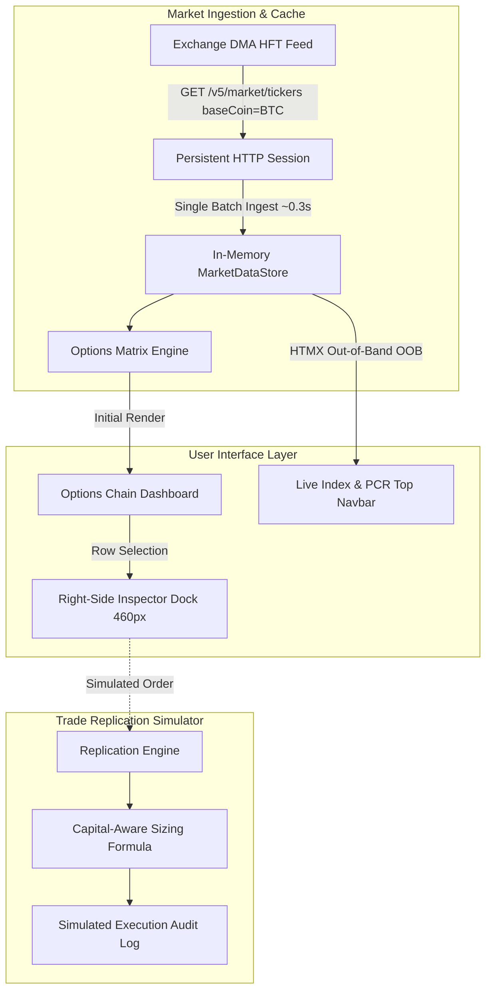

# MIRROR · Institutional Options Terminal & Trade Replication Engine

[](https://www.python.org/)
[](https://www.djangoproject.com/)
[](https://htmx.org/)
[](https://alpinejs.dev/)
[](https://tailwindcss.com/)
[](https://github.com/DRIRU/mirror)

**Mirror** is a high-density, institutional-grade cryptocurrency options analytics terminal and capital-aware trade replication simulator. Built with Django, HTMX, Alpine.js, and an ultra-fast market ingestion engine, Mirror delivers real-time options chain matrices, live Greeks, dynamic moneyness calculation, and master-to-follower trade mirroring.

---

## ⚡ Key Highlights

- **Ultra-Fast Batch Market Ingestion**: Ingests all 680+ active BTC option contracts across all expiries and strikes in a single batch query (~0.3s) via connection-pooled HTTP Keep-Alive sessions.
- **Instant Expiry Navigation**: All desk quotes are cached in-memory, making tab switching between expiries instantaneous (~60ms).
- **Dedicated Right-Hand Inspector**: Clicking any contract opens a sleek 460px inspector dock on desktop with zero table overlap, full Greek breakdown ($\Delta, \Gamma, \theta, \nu$), spreads, and 1-tap Call/Put toggling.
- **High-Density Mobile UI**: Touch-first responsive view with a segmented matrix switcher (`[Calls | Both | Puts]`), touch-scroll DTE expiry ribbon, and slide-up inspection bottom sheet.
- **Capital-Aware Trade Mirror**: Proportional equity sizing engine with multiplier caps and audit logging.
- **Hard Safety Isolation**: Execution routes remain strictly unwired and operating in simulation / dry-run mode.

---

## 🏗️ Architecture



---

## 📊 Features & Capabilities

### 1. High-Precision Options Chain Matrix
- **16-Column Desktop Terminal**: Full visibility across Delta ($\Delta$), Implied Volatility ($IV$), Open Interest ($OI$), Bid/Ask Sizes, Bids, Asks, Last Traded, and Strike boundaries.
- **Real-Time Moneyness Detection**: Dynamic flagging for Deep ITM, ATM, and OTM contracts based on spot index.
- **Settlement Detection**: Automated warning banner for 0-DTE settlement freeze windows.

### 2. Side-Sensitive Contract Inspector
- **Desktop Dock (Right Side)**: Slides in from the right edge with `lg:pr-[460px]` dynamic table clearance so no columns are hidden.
- **Mobile Sheet (Bottom)**: Ergonomic bottom sheet with drag handle and backdrop overlay for one-handed operation.
- **Bento Greeks Grid**: Generous 2x2 cards for Delta ($\Delta$), Gamma ($\Gamma$), Theta ($\theta$), and Vega ($\nu$).
- **Instant Toggle**: 1-tap `⇄ View Alternate Side` toggle to switch between Call and Put without closing the inspector.
- **Keyboard Shortcut**: Press <kbd>Esc</kbd> anytime to dismiss the inspector.

### 3. Capital-Aware Trade Mirroring (Milestone 2)
Proportionally calculates follower order sizing based on account equity balances:

$$\text{Follower Qty} = \text{Master Qty} \times \left(\frac{\text{Follower Equity}}{\text{Master Equity}}\right) \times \text{Allocation Ratio}$$

- **Safety Bounds**: Enforces step rounding (`qtyStep: 0.01 BTC`) and individual maximum contract caps (`max_contract_qty`).
- **Simulated Execution**: Replications are audited and logged in the database without sending live order payloads to the exchange.

---

## 🚀 Quickstart Guide

### 1. Clone the Repository
```bash
git clone https://github.com/DRIRU/mirror.git
cd mirror
```

### 2. Set Up Virtual Environment
```bash
python -m venv venv
# Windows (PowerShell):
.\venv\Scripts\Activate.ps1
# Linux / macOS:
source venv/bin/activate
```

### 3. Install Dependencies
```bash
pip install django requests cryptography python-dotenv
```

### 4. Configure Environment Variables
Create a `.env` file in the project root:
```env
COINSWITCH_API_KEY=your_api_key_here
COINSWITCH_SECRET_KEY=your_ed25519_hex_private_key_here
COINSWITCH_BASE_URL=https://dma.coinswitch.co
DJANGO_SECRET_KEY=your_django_secret_key
DJANGO_DEBUG=True
```

### 5. Run Migrations & Start Server
```bash
python manage.py migrate
python manage.py runserver 127.0.0.1:8000
```
Open [http://127.0.0.1:8000](http://127.0.0.1:8000) in your browser.

---

## 🧪 Testing

Mirror includes a comprehensive unit and integration test suite covering responsive viewports, HTMX partials, mobile components, and replication sizing safety.

Run the test suite:
```bash
python manage.py test apps.market_data apps.replication
```

---

## 📁 Repository Structure

```text
mirror/
├── apps/
│   ├── market_data/             # Options chain and market ingestion
│   │   ├── services/
│   │   │   ├── coinswitch_api.py# Pooled HTTP client & Ed25519 signing
│   │   │   ├── quote_service.py # In-memory thread-safe cache & batch worker
│   │   │   └── chain_builder.py # Matrix aggregation, Greeks, PCR, moneyness
│   │   ├── views.py             # HTMX & view controllers
│   │   ├── urls.py              # Market data routing
│   │   └── tests.py             # Integration & mobile DOM tests
│   └── replication/             # Trade mirror simulation engine
│       ├── models.py            # Master, Follower, and Audit models
│       ├── services/
│       │   ├── sizing.py        # Proportional equity sizing formula
│       │   └── replicator.py    # Unwired dry-run replication logic
│       ├── views.py             # Replication dashboard views
│       ├── urls.py              # Replication routing
│       └── tests.py             # Sizing and validation unit tests
├── config/                      # Django project configuration
│   ├── settings.py
│   ├── urls.py
│   └── wsgi.py
├── static/
│   └── css/
│       └── terminal.css         # Google Stitch Obsidian Precision theme
├── templates/
│   ├── base.html                # Institutional dark layout with navbar & live status
│   ├── market_data/
│   │   ├── chain.html           # Main chain dashboard & right inspector dock
│   │   └── partials/
│   │       ├── chain_table.html # Desktop & mobile options chain tables
│   │       └── drawer.html      # Focused single-contract inspector partial
│   └── replication/
│       └── overview.html        # Trade mirror dashboard & audit logs
├── .gitignore                   # Security, secrets, and database exclusions
├── manage.py
└── README.md
```

---

## 🛡️ Safety & Execution Boundary

> **STRICT SAFETY NOTICE**:  
> The trade replication and order routing components in `apps.replication` are strictly **isolated and unwired** from live exchange execution endpoints.  
> All replication runs in simulation / dry-run mode for safety. Order placement, position opening, leverage modification, and fund transfers are intentionally decoupled from this repository.

---

## 📜 License

Distributed under the MIT License. See `LICENSE` for more information.
